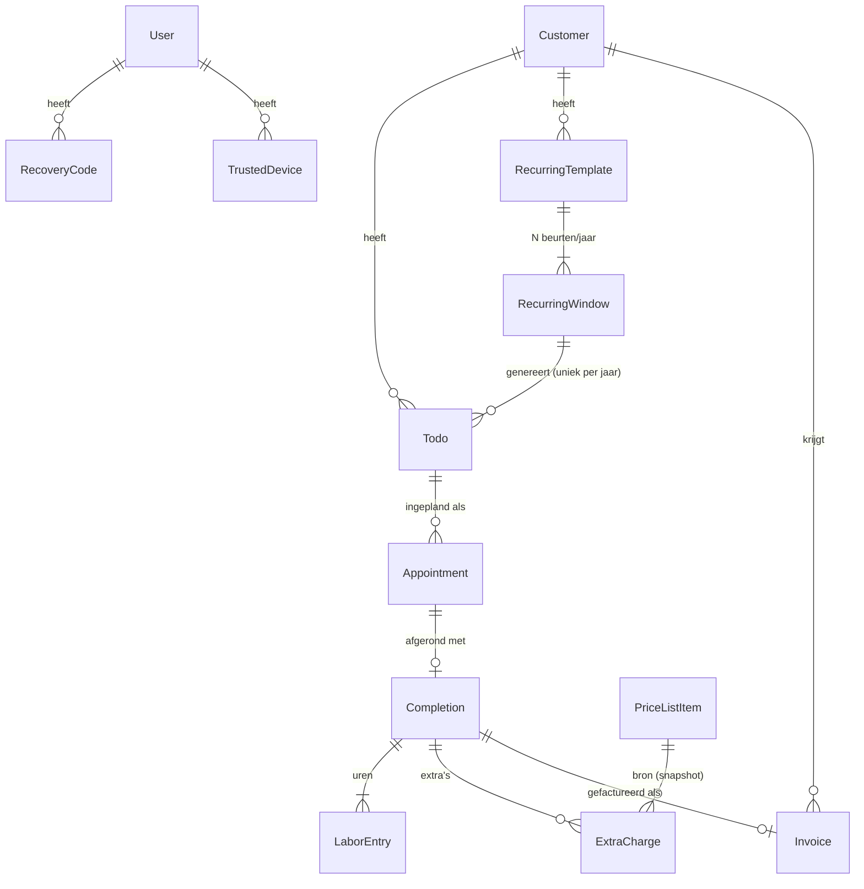

# Architectuur

> Technische documentatie voor wie aan de app ontwikkelt. De functionele
> handleiding voor de gebruiker komt in [handleiding.md](handleiding.md) (Fase 6).

## Overzicht

Eén **Next.js-applicatie** (App Router) die zowel de frontend als de backend
levert. Er is bewust géén aparte API-server: route handlers onder `/api/*`
vormen de REST-API, en in productie draait alles in één Docker-container naast
een PostgreSQL-container.

```
Browser / telefoon (PWA)
        │  HTTPS
        ▼
┌─ Caddy (reverse proxy, automatische HTTPS) ──────── alleen productie ─┐
│                                                                        │
│   ┌─ Next.js (één container) ─────────────────────────────────────┐   │
│   │  • Pagina's (React client components)                          │   │
│   │  • Route handlers  /api/*  (REST, zod-validatie)               │   │
│   │  • middleware.ts   (sessiecontrole op elke pagina)             │   │
│   │  • instrumentation.ts → croner-jobs (reminders, recurring)     │   │
│   └──────────────┬────────────────────────────────────────────────┘   │
│                  │ Prisma (driver-adapter @prisma/adapter-pg)          │
│   ┌──────────────▼───────────────┐                                     │
│   │  PostgreSQL 17 (container)   │  + nachtelijkse pg_dump-backup      │
│   └──────────────────────────────┘                                     │
└────────────────────────────────────────────────────────────────────────┘
          │ uitgaand                         │ uitgaand
          ▼                                  ▼
  SMTP (Brevo) — herinneringsmails    EenvoudigFactureren API — conceptfacturen
```

## Stackkeuzes en waarom

| Laag | Keuze | Waarom |
|---|---|---|
| Framework | Next.js 15 (App Router), TypeScript | React-kennis aanwezig; frontend + API in één codebase en één container |
| Styling | Tailwind CSS 4 | Snel, consistent, geen aparte CSS-bestanden per component |
| Data-ophaling | TanStack Query | Caching, loading states en invalidatie zonder eigen plumbing |
| Database | PostgreSQL 17 + Prisma 7 | Declaratief schema, migraties, typed client; Prisma 7 werkt met een driver-adapter (`@prisma/adapter-pg`) en heeft geen Rust-binaries meer nodig in het Docker-image |
| Datums | Luxon, opslag altijd UTC | Alle "dag"-logica expliciet in `Europe/Brussels` → DST-veilig |
| Cron-jobs | croner in `instrumentation.ts` | IANA-timezone-ondersteuning; app draait op precies één instance |
| E-mail | nodemailer over SMTP | Provider-onafhankelijk; start met Brevo (gratis tier, geen eigen domein nodig) |
| Auth | iron-session + TOTP (otplib 13) | Versleutelde cookie = geen session store; 2FA met elke authenticator-app |

### Afwijkingen t.o.v. het oorspronkelijke plan

- **Prisma 7 i.p.v. 6**: nieuwere major, vereist `prisma.config.ts` (vervangt de
  `prisma`-sleutel in package.json én de `url` in schema.prisma) en een
  driver-adapter in de client. De gegenereerde client staat in `src/generated/prisma/`
  (gitignored; `npm install` regenereert hem via het postinstall-script).
- **TypeScript vastgepind op 5.9**: TypeScript 7 (de Go-herschrijving) breekt het
  laden van `next.config.ts` in Next 15. Niet upgraden zolang Next 15 gebruikt wordt.
- **otplib 13**: functionele API (`generateSecret`, `generateURI`, `verify`) in
  plaats van het oude `authenticator`-object.

## Mappenstructuur

```
├─ prisma/                 schema.prisma (datamodel), migrations/, seed.ts
├─ prisma.config.ts        Prisma 7-config: datasource-url, seed-commando
├─ docker-compose.yml      dev: alleen PostgreSQL (hostpoort 5433!)
└─ src/
   ├─ middleware.ts        sessiecontrole; stuurt anonieme bezoekers naar /login
   ├─ lib/
   │  ├─ config.ts         env-parsing met zod — faalt hard bij foute config
   │  ├─ db.ts             Prisma-singleton (HMR-veilig)
   │  ├─ session.ts        iron-session (SessionData, cookienamen)
   │  ├─ api.ts            requireUser-guard + uniforme foutafhandeling
   │  ├─ auth/totp.ts      2FA: TOTP, geheim-versleuteling, herstelcodes, vertrouwde toestellen
   │  ├─ auth/rate-limit.ts in-memory login-limiter
   │  └─ schemas/          zod-contracten, gedeeld door server én client
   ├─ app/
   │  ├─ api/…/route.ts    REST-endpoints
   │  ├─ login/            loginflow (wachtwoord → TOTP → eventueel setup)
   │  └─ (app)/            beveiligde schermen binnen de app-shell
   └─ components/          app-shell, navigatie, gedeelde UI
```

## Datamodel

Zie [prisma/schema.prisma](../prisma/schema.prisma) — elk model is daar gedocumenteerd.



Kernprincipes:

- **Snapshots**: `LaborEntry` en `ExtraCharge` kopiëren tarief/btw op het moment
  van registratie. De prijslijst mag dus vrij gewijzigd worden zonder dat oude
  registraties of facturen veranderen.
- **Idempotente recurring-generatie**: `@@unique([recurringWindowId, occurrenceYear])`
  op `Todo` garandeert dat een beurt per jaar maar één keer gegenereerd wordt,
  hoe vaak de job ook draait.
- **UTC overal**: dagvergelijkingen ("afspraken van morgen") gebeuren in code via
  Luxon in `Europe/Brussels`, nooit met databasefuncties of serverlokale tijd.

## Hoe een request loopt

1. Browser vraagt een pagina → `middleware.ts` ontsleutelt de sessiecookie
   (iron-session). Geen volledige sessie → redirect `/login`.
2. De pagina (client component) haalt data op via `fetch("/api/…")` met
   TanStack Query.
3. De route handler valideert de invoer met zod (`lib/schemas/…`), controleert
   de sessie opnieuw via `requireUser()` (defense in depth) en praat via de
   Prisma-client (`lib/db.ts`) met PostgreSQL.
4. Fouten lopen door `handleApiError()` → consistente `{ error }` JSON met
   passende status (400 validatie, 401 auth, 500 onverwacht).

## Authenticatie & 2FA

- **Stap 1** `POST /api/auth/login`: bcrypt-controle. Resultaat: volledig
  aangemeld (vertrouwd toestel), `needsTotp` of `needsTotpSetup` (eerste keer).
  De sessie bevat dan enkel `pendingUserId` — nog géén toegang.
- **Setup** `POST /api/auth/totp/setup` → QR-code (otpauth-URI). Het geheim leeft
  tot bevestiging alleen in de versleutelde sessiecookie. `…/confirm` controleert
  de eerste code, bewaart het geheim **AES-256-GCM-versleuteld** (sleutel afgeleid
  van `SESSION_SECRET`) en geeft eenmalig 8 herstelcodes terug (alleen hashes in DB).
- **Stap 2** `POST /api/auth/totp/verify`: TOTP-code of herstelcode. Optioneel
  "vertrouw dit toestel 30 dagen": random token in een httpOnly-cookie, alleen de
  sha256-hash in de database.
- Rate-limiting: max 10 pogingen per 15 min per IP (login) en per gebruiker (TOTP).
- Een nieuwe 2FA-setup maakt alle oude herstelcodes en vertrouwde toestellen ongeldig.

## PWA

- `@serwist/next` bundelt een service worker (`src/app/sw.ts`) bij de
  productie-build; in development staat hij uit (HMR-conflict).
- Strategie: app-shell/assets gecachet, **alle `/api/*`-verkeer NetworkOnly** —
  planning- en registratiedata mogen nooit uit een cache komen. Geen
  offline-synchronisatie in v1 (bewuste keuze: grootste complexiteitsvalkuil).
- Manifest via `src/app/manifest.ts`; iconen in `public/icons/` (plus
  `src/app/icon.png` en `apple-icon.png` voor favicon/iOS). De iconen zijn
  programmatisch gegenereerde placeholders — vervang ze gerust door een logo
  (zelfde bestandsnamen en formaten volstaan).

## Productie (samenvatting — volledig runbook in deployment.md)

- Multi-stage `Dockerfile`: standalone Next.js-server in `/app`, en in
  `/tools` de Prisma-CLI + schema. Het entrypoint draait bij elke start
  `prisma migrate deploy` + de idempotente seed, en start dan de server.
- `docker-compose.prod.yml`: app + postgres + caddy (automatische HTTPS) +
  nachtelijkse pg_dump-backups (7d/4w/6m retentie).
- **Nooit meer dan 1 app-replica** — de cronjobs draaien in het appproces.
- Build-stage gebruikt dummy-env-waarden (DATABASE_URL, SESSION_SECRET): de
  route-modules valideren hun config al tijdens "collecting page data".

## Lokale ontwikkeling

- `docker-compose.yml` draait PostgreSQL op **hostpoort 5433** (5432 was op de
  dev-machine al bezet door een andere container).
- `.env` wordt door Next.js automatisch geladen; de Prisma-CLI laadt hem via
  `import "dotenv/config"` in `prisma.config.ts`.
- Seed (`npm run db:seed`) is idempotent: bestaande gebruikers/instellingen
  worden nooit overschreven.
- ⚠ Dev-server en `npm run build` delen de `.next`-map: **stop `npm run dev`
  vóór je lokaal een productie-build draait**, anders raakt de dev-cache
  corrupt ("Cannot find module './chunks/…'"). Herstel: `.next` verwijderen en
  de dev-server herstarten. Typecheck zonder build: `npx tsc --noEmit`.
